# Roteiro de implementação — wacrm SaaS

Plano das implementações para transformar o wacrm em SaaS. Cada item tem um ID usado no
grafo e na tabela. Ao concluir um item, marque o status aqui e registre no
`docs/CLAUDE_HANDOFF.md`. Estimativas em dias úteis de desenvolvimento.

Status: ⬜ a fazer · 🟨 em andamento · ✅ feito

## Grafo de dependências

Seta `A --> B` = B depende de A. Itens sem seta entre si podem ser feitos em paralelo.

```mermaid
flowchart TD
    classDef meta fill:#fde68a,stroke:#b45309,color:#000
    classDef base fill:#bfdbfe,stroke:#1d4ed8,color:#000
    classDef wa fill:#bbf7d0,stroke:#15803d,color:#000
    classDef bill fill:#e9d5ff,stroke:#7e22ce,color:#000
    classDef ops fill:#e5e7eb,stroke:#374151,color:#000
    classDef goal fill:#fecaca,stroke:#b91c1c,color:#000,font-weight:bold

    subgraph M["Trilha Meta (burocracia, começar já)"]
        M1["M1 · Verificar empresa<br/>no Meta Business"]
        M2["M2 · Virar Tech Provider"]
        M3["M3 · Revisão do app<br/>(permissões WhatsApp)"]
        M1 --> M2 --> M3
    end

    subgraph F1["Fase 1 — MVP vendável"]
        direction TB
        subgraph CANAIS["Canais e setores"]
            C1["C1 · Vários números por conta<br/>(tabela de canais, conversa → canal)"]
            C2["C2 · Acesso por setor<br/>(RLS por canal)"]
            C3["C3 · Transferir conversa<br/>entre setores"]
            C1 --> C2 --> C3
        end
        subgraph WHATS["WhatsApp multi-provedor"]
            W1["W1 · Camada de provedor<br/>(interface Meta / Evolution)"]
            W2["W2 · Evolution: webhook<br/>de entrada + envio"]
            W3["W3 · Instância automática<br/>+ QR code"]
            W4["W4 · Regras por provedor<br/>(24h, templates, botões)"]
            W5["W5 · Fila de campanhas<br/>(Redis, intervalo anti-ban)"]
            W1 --> W2
            W2 --> W3
            W2 --> W4
            W2 --> W5
        end
        subgraph COB["Cobrança e planos"]
            B1["B1 · Planos, limites e<br/>recursos por plano"]
            B2["B2 · Cobrança Asaas<br/>(assinatura + webhook)"]
            B3["B3 · Assentos: usuário<br/>adicional pago"]
            B4["B4 · Limite de números<br/>por plano"]
            B5["B5 · Cadastro → plano<br/>→ pagamento"]
            B6["B6 · Painel do dono<br/>(clientes, status, uso)"]
            B1 --> B2
            B2 --> B3
            B2 --> B5
            B2 --> B6
        end
        subgraph OPS["Produção e legal"]
            O1["O1 · Infra: VPS, Supabase nuvem,<br/>SMTP, cron, backup, monitoramento"]
            O2["O2 · LGPD: termos, privacidade,<br/>excluir conta"]
            O3["O3 · Nota fiscal (NFS-e)"]
        end
    end

    C1 --> W1
    C1 --> B4
    B1 --> B4
    B2 --> O3

    LANC(["🚀 Lançamento MVP"])
    C3 --> LANC
    W3 --> LANC
    W4 --> LANC
    W5 --> LANC
    B3 --> LANC
    B4 --> LANC
    B5 --> LANC
    B6 --> LANC
    O1 --> LANC
    O2 --> LANC
    O3 --> LANC

    subgraph F2["Fase 2 — Meta oficial por coexistência"]
        X1["X1 · Embedded Signup<br/>(botão Conectar WhatsApp)"]
        X2["X2 · Mensagens do celular<br/>na inbox (echoes)"]
        X3["X3 · Importar histórico<br/>e contatos"]
        X1 --> X2
        X1 --> X3
    end
    M3 --> X1
    W1 --> X1
    LANC --> X1

    subgraph F3["Fase 3 — Recursos dos planos maiores"]
        P1["P1 · Distribuição automática<br/>de leads por setor"]
        P2["P2 · Relatórios por atendente<br/>e etapa + exportação"]
        P3["P3 · Cota mensal da API"]
        P4["P4 · IA incluída no plano<br/>(com limite de uso)"]
        P5["P5 · Rate limit no Redis<br/>(várias instâncias)"]
    end
    C2 --> P1
    B1 --> P3
    B1 --> P4
    W5 --> P5
    LANC --> F3

    class M1,M2,M3 meta
    class C1,C2,C3 base
    class W1,W2,W3,W4,W5,X1,X2,X3 wa
    class B1,B2,B3,B4,B5,B6,P3,P4 bill
    class O1,O2,O3,P1,P2,P5 ops
    class LANC goal
```

## Caminho crítico

O caminho mais longo até o lançamento passa pelos canais e pelo Evolution:

**C1 (6–8) → W1 (2–3) → W2 (3–4) → W5 (3–4)** ≈ 14–19 dias.

Cobrança (B1 → B2 → B3/B5/B6) e produção (O1–O3) correm em paralelo. A trilha Meta (M1–M3)
não depende de código: comece já, porque a aprovação leva semanas e trava a Fase 2.

## Itens

### Trilha Meta

| ID | Item | Depende de | Estimativa | Status |
|---|---|---|---|---|
| M1 | Verificar a empresa no Meta Business (CNPJ, documentos) | — | burocracia | ⬜ |
| M2 | Cadastro como Tech Provider | M1 | burocracia | ⬜ |
| M3 | Revisão do app com as permissões de WhatsApp (vídeo do fluxo) | M2 | semanas | ⬜ |

### Fase 1 — MVP vendável

| ID | Item | Depende de | Estimativa | Status |
|---|---|---|---|---|
| C1 | Vários números por conta: tabela de canais (nome do setor, provedor), `channel_id` na conversa, envio pelo número certo, webhook roteando por canal. Sai o `UNIQUE(account_id)` do `whatsapp_config`. Spec: `docs/saas/c1-canais.md`. | — | 6–8 | 🟨 implementado na branch `feat/c1-canais`, falta revisar e fazer merge |
| C2 | Acesso por setor: atendente vinculado a canais e só vê a inbox deles; dono/admin veem tudo. **No banco (RLS)**, não só na tela. | C1 | 3–4 | ⬜ |
| C3 | Transferir conversa entre setores | C2 | 1–2 | ⬜ |
| W1 | Camada de provedor: interface única (`sendText`, `sendMedia`, `sendReaction`, `sendTyping`, `getMedia`, `health`); Meta passa a ser uma implementação dela | C1 | 2–3 | ⬜ |
| W2 | Evolution v2: rota de webhook que traduz `messages.upsert`/`messages.update` para o fluxo existente (`processMessage`), envio de texto/mídia, ignora grupos | W1 | 3–4 | ⬜ |
| W3 | Criar a instância Evolution automaticamente ao adicionar um número + tela de QR code + status de conexão | W2 | 2 | ⬜ |
| W4 | Regras por provedor: sem janela de 24h nem template obrigatório no Evolution; esconder templates e botões interativos nesses números | W2 | 2–3 | ⬜ |
| W5 | Fila de campanhas (Redis + worker) com intervalo entre envios | W2 | 3–4 | ⬜ |
| B1 | Planos e limites: tabela de planos, assinatura por conta, travas de recursos por plano | — | 2–3 | ⬜ |
| B2 | Cobrança no Asaas: assinatura recorrente (Pix/boleto/cartão) + webhook ativa/suspende a conta | B1 | 3–4 | ⬜ |
| B3 | Assentos: usuários incluídos por plano + usuário adicional pago; convite bloqueado sem assento; viewer sem custo | B2 | 2 | ⬜ |
| B4 | Limite de números por plano (2 / 5 / 7) | B1, C1 | 0,5 | ⬜ |
| B5 | Fluxo de cadastro: criar conta → escolher plano → pagar → entrar (teste grátis opcional) | B2 | 2–3 | ⬜ |
| B6 | Painel do dono do SaaS: clientes, plano, pagamento, suspender/reativar, uso | B2 | 2–3 | ⬜ |
| O1 | Produção: VPS, Supabase na nuvem, SMTP próprio, cron das automações, backup, monitoramento e alerta de disco | — | 1–2 | ⬜ |
| O2 | LGPD: termos de uso, política de privacidade, tela de excluir conta e dados | — | 2 | ⬜ |
| O3 | Nota fiscal automática (NFS-e pelo Asaas) | B2 | 0,5–1 | ⬜ |

### Fase 2 — Meta oficial por coexistência

| ID | Item | Depende de | Estimativa | Status |
|---|---|---|---|---|
| X1 | Embedded Signup com coexistência: botão "Conectar WhatsApp", troca do código por token, inscrição automática do webhook | M3, W1, lançamento | 3–4 | ⬜ |
| X2 | Mensagens enviadas pelo celular aparecem na inbox (`smb_message_echoes`) | X1 | 1–2 | ⬜ |
| X3 | Importar histórico e contatos enviados pela Meta na conexão | X1 | 2 | ⬜ |

### Fase 3 — Recursos dos planos maiores

| ID | Item | Depende de | Estimativa | Status |
|---|---|---|---|---|
| P1 | Distribuição automática de leads (rodízio por setor) | C2 | 2–3 | ⬜ |
| P2 | Relatórios por atendente e por etapa + exportação | — | 3 | ⬜ |
| P3 | Cota mensal de requisições da API por plano | B1 | 1 | ⬜ |
| P4 | IA incluída no plano, com a chave do SaaS e limite de uso | B1 | 2 | ⬜ |
| P5 | Rate limit no Redis, para rodar mais de uma instância do app | W5 | 1 | ⬜ |

## Totais

| Bloco | Estimativa |
|---|---|
| Fase 1 (soma de tudo) | ~37–51 dias de trabalho; com cobrança e infra em paralelo ao caminho crítico, ~4–6 semanas |
| Fase 2 | ~6–8 dias, depois da aprovação da Meta |
| Fase 3 | ~9–10 dias |

As estimativas vêm da leitura do código em 2026-10-25 e devem ser revistas ao detalhar cada item.

## Decisões em aberto

- Valor do usuário adicional.
- Cota da API do Profissional (sugestão: ~10.000/mês em vez de 1.000).
- Implantação obrigatória ou opcional no Essencial.
- Evolution v2 (sugerido) ou Evolution Go.
- Teste grátis: duração e limites.
